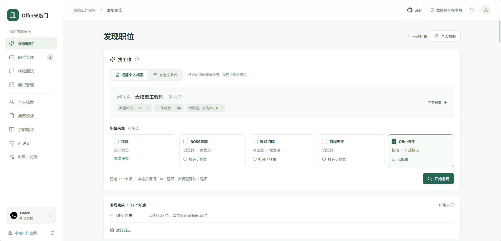

<p align="center"></p>
<h1 align="center">Offer Knocks · Offer来敲门</h1>
<p align="center"><strong>You deserve a better job.</strong></p>
<p align="center">A local AI workspace for job discovery, applications, and interview practice</p>
<p align="center"><a href="README.md">中文</a> · English · <a href="docs/usage.md">User Guide</a> · <a href="docs/ai-engines.md">Engine Setup</a></p>

**Offer Knocks** is an AI assistant for your entire job search. Find opportunities that fit, present your strengths through real experience, and prepare for each interview. From tailored resumes to application tracking and interview reviews, it helps you take each next step with better preparation. The interface is currently in Chinese.

## Features

- **Job discovery** — Search multiple recruitment sources using your profile or custom criteria. Each source defaults to 50 raw results, configurable in Settings.
- **Tailored resumes** — Import an existing resume, generate application materials, and export six templates to Word, PDF, or Markdown.
- **Application tracking** — Track progress and preserve snapshots of listings and submitted materials.
- **Interview practice** — Generate preparation packs, questions, and reference answers; practice through text or voice with a 3D interviewer and per-answer feedback.
- **Progress review** — Keep interview records and notes, and revisit previous practice sessions.



## Quick Start

### Requirements

- **Node.js: recommended 24+; minimum 22.13.0 (not yet verified).** npm is required.
- At least one installed, authenticated **Codex, CodeBuddy, or Claude Code CLI** with available quota. See [Engine Setup](docs/ai-engines.md).
- **Edge or Chrome** to retrieve job listings from certain recruitment platforms and export PDFs.


### Run Locally

```bash
git clone https://github.com/aunicall/ai-job-search-zh.git
cd ai-job-search-zh
npm ci
npm run dev
```

Open [http://127.0.0.1:3001](http://127.0.0.1:3001), test your engine under **引擎与设置** (Engines & Settings), and complete your profile.

The application is intended for a single local user. Recruitment browsing requires an interactive desktop for sign-in and verification; these workflows are not directly supported on headless servers or containers.

To run a production build:

```bash
npm run build
npm start
```

The app listens on `127.0.0.1` by default and requires a local CLI and writable storage. Static hosting is not supported. There is no account authentication; do not expose it directly to the public internet.

> Testing note: Codex (`0.142.5`) and CodeBuddy (`2.172.1`) have passed real-account end-to-end tests. Claude Code integration and Skill installation are implemented, but have not been tested because the author has no account. If you have a Claude Code account, contributions to testing are very welcome—thank you! This does not mean every recruitment platform and account has been verified.

## Configuration

Copy [.env.example](.env.example) to `.env.local` in the same directory, then uncomment and edit the settings you need. Edit an existing file rather than overwriting it. All settings are optional; restart the server after changes.

| Variable | Purpose | Default |
| --- | --- | --- |
| `PORT` | Server port | `3001` |
| `OFFER_DATA_DIR` | Data directory; prefer an absolute path outside the repository | `./data` |
| `OFFER_AI_TIMEOUT_MS` | AI generation timeout in milliseconds | `180000` |
| `OFFER_BROWSER_CHANNEL` | Browser: `msedge` or `chrome` | Edge on Windows, Chrome elsewhere |
| `OFFER_CAMPUS_API_KEY` | Offer先生 campus-recruitment API key | Source unavailable until configured |

For example, `PORT=3002` changes the address to `http://127.0.0.1:3002` in both development and production. Use `--port` for a temporary override. Authentication is managed by each CLI; commands and models are configured in the app.

## Recruitment Sources

| Source | Integration and requirements |
| --- | --- |
| 猎聘 / Liepin | Page-based public search and listing details, with a browser fallback. Some details require sign-in or verification. |
| BOSS直聘 | Local browser; sign in and configure your platform job preferences. Uses pagination or scrolling and remains subject to verification and rate limits. |
| 智联招聘 / Zhaopin | Local browser with sign-in; uses pagination or load-more controls. Details depend on your account's access. |
| 前程无忧 / 51job | Local browser with pagination or load-more controls; complete sign-in or verification when required. |
| Offer先生 / Offer Xiansheng | Campus announcements through the official `offer-skill`, using cursor pagination and an [API key](https://developer.offerxiansheng.com/docs/ai). All three engines install a missing Skill from the official source into the user directory; it is not bundled. |

In **引擎与设置** (Engines & Settings), set the raw search limit per source: **50 by default**, configurable from 1 to 500. Multiple keywords share the source's allowance for that search. Fetching stops at the limit or when no new results appear; deduplication and filtering can reduce the final count. Browser pagination has not yet been verified while signed in on every platform.

Availability depends on platform changes, account permissions, and access restrictions. The app does not bypass verification or submit applications automatically. You can also add listings manually.

## Data & Privacy

### Privacy

- **Identity stays local.** Your profile name, phone number, and email are not intentionally sent to AI. Local code adds them to your resume and handles your photo.
- **AI processes job-search content.** Known identity details are redacted before sending relevant experience, skills, listings, notes, interview questions, and answers to the selected CLI. Codex, CodeBuddy, and Claude Code use their configured OpenAI, Tencent, or Anthropic services; a third-party model or gateway configured in the CLI receives the content instead. Free text still needs your review.
- **Recruitment and speech services.** Keywords, cities, and other search criteria go to the selected recruitment platforms. Offer先生 receives supported query parameters, not a full resume. Windows local speech runs on-device; browser speech recognition or synthesis may send audio or text to the provider configured by the browser or operating system.

### Storage

Profiles, job-search records, and attachments are stored locally in `data/`. Set `OFFER_DATA_DIR` to choose another location. Do not commit personal data or `.env.local`.

| Data | Default location |
| --- | --- |
| Profiles, jobs, settings, interview questions, and answers | `data/offer.sqlite` (SQLite; `-wal` and `-shm` files may also exist while running) |
| Imports, generated materials, and profile photos | `data/workspace/`; the file directory can also be changed in the app |
| Recruitment browser cookies and sign-in sessions | `data/source-browser/` |
| AI credentials and official Skills | Managed in the current OS user's directory; see [Engine Setup](docs/ai-engines.md) |

Stop the server before backing up the entire data directory, including any separately configured file directory. JSON export excludes attachments, and the app currently has no web-based restore feature. See the [User Guide](docs/usage.md#数据备份与迁移) for the full procedure.

## Documentation

- [User Guide](docs/usage.md) — Profiles, job discovery, applications, and interviews.
- [Engine Setup](docs/ai-engines.md) — CLI installation, authentication, and troubleshooting.

Detailed guides are currently in Chinese.

## Community

Follow the project's WeChat official account for discussion and feedback.


## Acknowledgments

-  Inspired by the job-search workflows in [MadsLorentzen/ai-job-search](https://github.com/MadsLorentzen/ai-job-search).

- Built with [Codex](https://openai.com/codex/) by [OpenAI](https://openai.com/)

## License

Project code is licensed under [Apache-2.0](LICENSE).

## Disclaimer

This project is provided for personal learning and research, without guarantees regarding generated content, service availability, or employment outcomes. Users are responsible for complying with applicable laws and third-party platform rules, verifying generated content, and their own use of the project. The authors and contributors accept no liability for losses arising from misuse.
